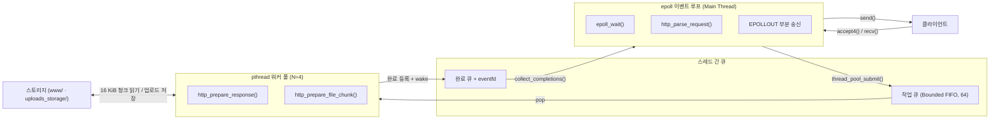
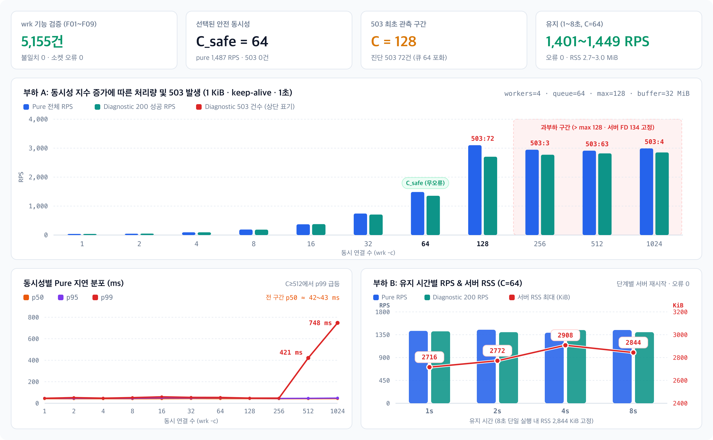

# Team 9 Web Server

외부 HTTP·이벤트 루프 라이브러리 없이 **C11과 POSIX / Linux 시스템콜 API**만으로 구현한 HTTP/1.1 웹 서버입니다.

---

## 1. 프로젝트 소개 (설계 철학)

### 1. 점진적 확장
- 단일 `socket → bind → listen → accept` 루프에서 시작해 **요청 파싱(A) → 응답 생성·송신(B) → POST/JSON/업로드 확장 → Persistent Connection → `epoll` + `pthread` 동시성** 순으로 책임을 분리하며 확장했습니다.
- 각 단계에서 발생한 트레이드오프와 정책 변경 이유, 현재 구현의 한계(미구현 기능·비보장 범위)를 [docs/arch_procedure.md](docs/arch_procedure.md)에 기록해 동작 근거를 추적할 수 있도록 했습니다.

### 2. 재사용성 및 확장성 고려
- **수신과 파싱 분리**: `http_parse_request`를 소켓 I/O와 무관한 순수 버퍼 파서로 설계해, 네트워크 없이 단위 테스트가 가능하고 직렬 `poll` 구조에서 비동기 `epoll` 이벤트 루프로 그대로 재사용할 수 있었습니다.
- **I/O 루프와 워커 풀 분리**: 메인 스레드(`event_loop`)가 모든 소켓 FD·수신 버퍼·`EPOLLOUT` 송신을 단독 소유하고, `pthread` 워커 풀은 응답 준비와 파일 읽기만 수행하도록 경계를 나눠 느린 클라이언트 I/O가 워커를 점유하지 않게 했습니다.
- **명시적 자원 경계와 CLI 설정**: 워커 수·작업 큐·최대 연결 수·전체 수신 버퍼 예산을 CLI 인자(`--worker`, `--queue`, `--max`, `--buffer`)로 분리해 재빌드 없이 실행 환경에 맞춰 조정할 수 있습니다.

---

## 2. 아키텍처 (전체 플로우)

앞단의 **단일 `epoll` 이벤트 루프(Main Thread)**가 다중 연결의 수락·수신·파싱·송신을 담당하고, 완성된 요청만 **제한된 작업 큐(Bounded FIFO)**를 통해 **뒷단의 `pthread` 워커 풀**로 넘겨 처리합니다.



- **앞단 (`src/event_loop.c`)**: 논블로킹 `accept4`·`recv`로 데이터를 누적해 `http_parse_request`로 요청 완료 여부를 판정합니다. 최대 연결(128) 도달 시 `listener` 감시를 일시 중지하고, 작업 큐(64) 포화 시 신규 요청에는 메인이 고정 `503 + Connection: close`를 즉시 `EPOLLOUT`으로 전송합니다.
- **뒷단 (`src/thread_pool.c`)**: `mutex + condvar` 작업 큐에서 요청을 꺼내 소켓 I/O 없이 응답 헤더·본문 준비(`http_prepare_response`)와 정적 파일 16 KiB 청크 읽기(`http_prepare_file_chunk`)만 수행합니다.
- **완료 회수 및 재사용**: 워커가 완료 큐에 결과를 넣고 `eventfd`로 메인을 깨우면, 이벤트 루프가 `EPOLLOUT` 부분 송신을 진행하고 완료 후 Keep-Alive 재사용(최대 100요청) 또는 연결 정리를 수행합니다.

---

## 3. 주요 기능 (핵심 결정 사안)

### 3.1 HTTP/1.1 요청 파싱 및 프로토콜 경계
- **오프셋·길이 기반 필드 표현 (`http_field`)**: 버퍼 동적 확장(4 KiB → 최대 `32 KiB + 1 MiB`) 시 `realloc` 이후에도 포인터 무효화 없이 안전하게 필드를 참조합니다.
- **엄격한 프레이밍·오류 우선순위**: 요청 라인 8 KiB, 전체 헤더 32 KiB, 본문 1 MiB 상한을 두며 수신된 헤더의 문법 오류를 길이 오류보다 우선 판정합니다. 중복·비정상 `Content-Length`는 `400`, 단독 `Transfer-Encoding`은 `501`, 병용은 `400` 처리합니다.
- **Host B안 검증 & 시간 정책**: ASCII 도메인·IPv4·대괄호 IPv6·포트(1~65535)를 검증합니다. 헤더(5초)·POST 본문(10초)·유휴(5초)는 고정 절대 기한을, 응답 쓰기(5초)는 양수 `send` 성공 시 갱신되는 무진전 기한을 적용합니다.

### 3.2 정적 파일 서빙 및 경로 보안
- **전처리 및 `openat` 경로 보호**: `쿼리 분리 → 1회 퍼센트 디코딩 → 검증` 후 `www/` 기준 `openat(..., O_NOFOLLOW | O_NONBLOCK)`으로 경로 요소를 하나씩 열어 중간·최종 심볼릭 링크와 `..`를 차단(`403`)하고 일반 파일(`S_ISREG`)만 서빙합니다.
- **MIME 및 16 KiB 청크**: 확장자 7종(`.html`, `.css`, `.js`, `.json`, `.png`, `.jpg`, `.jpeg`) + 기본 `application/octet-stream`을 매핑하며, 워커가 연결당 16 KiB 청크 단위로 읽어 메인에 전달합니다.

### 3.3 동적 POST 처리 (직접 구현 JSON/폼 파서 및 Base64 업로드)
- **예약 API 라우팅**: `/api/users`(JSON), `/api/form`(URL 인코딩 폼), `/api/upload`(Base64 JSON)를 정적 경로보다 우선 분기합니다. 비-POST 메서드는 `405` + `Allow: POST`, 길이 누락은 `411`, 명시적 빈 본문(`Content-Length: 0`)은 `400`, 미지원 `Content-Type`은 `415`를 반환합니다.
- **직접 구현 파서와 복잡도 제한**: JSON 깊이 16·객체 100필드·배열 1,000원소·전체 값 10,000개·폼 100필드 초과 시 `413`으로 거절하며 중복 키·폼 빈 키·폼 NUL(`%00`/`0x00`)은 `400` 처리합니다. JSON 문자열은 길이 기반 UTF-8, 숫자는 원문 바이트를 유지합니다.
- **Base64 저장 및 락 없는 TLS 업로드 ID**: `www/` 외부의 `uploads_storage/`에 `<ID>.bin`·`<ID>.json`을 `O_CREAT | O_EXCL | O_NOFOLLOW (0600)`으로 생성한 뒤 완료 시 `fchmod(0400)` 읽기 전용으로 전환합니다. 업로드 ID는 전역 카운터 경합을 피하기 위해 스레드 로컬 기반 `PID_워커번호_로컬순번(uint64_t)`으로 발급합니다.

### 3.4 Persistent Connection 및 동시성·과부하 제어
- **Keep-Alive 정책**: 정상 유지 응답에는 `Connection` 헤더를 생략하고, 클라이언트 `close`·모든 오류 응답·100번째 응답에 `Connection: close`를 명시 후 종료합니다. GET은 헤더 완료 즉시 응답하되, 연결 재사용 시 `Content-Length`만큼 정확히 폐기(10초 기한)해 다음 요청 경계를 보존합니다.
- **과부하·오류 분리**: 연결 상한(128) 도달 시 `listener` 감시 일시 중지, 큐(64) 포화 시 신규 요청은 `503 + close`(진행 중인 파일 후속 읽기는 `READ_PENDING`에서 슬롯 확보 시 재제출), 수신 버퍼 `capacity` 총 예산(32 MiB) 초과 시 해당 연결 종료, 빈 EOF·읽기 오류는 워커 제출 없이 메인에서 즉시 정리합니다.
- **Graceful Shutdown (`SIGINT`/`SIGTERM`)**: 시그널 핸들러는 플래그와 `eventfd`만 갱신하고, 루프가 수락 중단·유휴/부분 수신 연결 정리 후 큐·워커·송신 중 작업만 완료(drain)하고 종료합니다.

---

## 4. 검증 및 성능

### 4.1 기능 · 안정성 · 동시성 검증
- **F1 단위·경계·오류 주입 (`make test`)**: 증분 파서, Host B안, 경로 보안, JSON/폼 복잡도, Base64 업로드 경계, 단조 시계 11시나리오, syscall 실패 주입 26시나리오, Persistent Connection, 4,400회 반복 FD/RSS 계측 통과 (macOS `ASan/UBSan` · Linux Docker `ASan/LSan/UBSan`).
- **F2 동시성·실제 서버 통합 (`make test-f2`)**: 제한 큐·TLS 업로드 ID·`accept4` 오류 복구·풀 실패 정리·빈 EOF 무제출 및 실제 `webserver` 대상 24 병렬 업로드, 연결 상한 pause/resume, `LD_PRELOAD` 장벽 기반 큐 포화 503·SIGTERM drain, 16 MiB 무수신 공존, UID 1000 권한 거부 통과 (일반 · `ASan/LSan/UBSan` · `TSan`).
- **wrk 격리 기능 검증 (`F01~F09`)**: 서버·부하 발생기 Docker 컨테이너 분리 환경에서 **총 5,155건** 검증(본문·길이·상태 불일치 0, 예상 밖 소켓 오류 0; F06/F07은 명시적 소켓/장벽 통합 테스트로 보완).

### 4.2 wrk 부하 테스트 시각화 (핵심 축약 표본)

> 측정 환경: Linux Docker (`aarch64`, GCC `11.4.0 -O2`), 서버·`wrk 4.1.0` 별도 컨테이너 분리, 기본 설정(`--worker 4 --queue 64 --max 128 --buffer 32`), `1 KiB` 정적 GET, Keep-Alive, `-t1`.



- **안전 동시성 (`C=1..64`)**: 오류 0으로 처리량이 선형 증가(`~24 → ~1,487 RPS`)해 **`C_safe = 64`**로 자동 선정되었습니다.
- **큐 포화 및 수락 상한 (`C=128..1024`)**: `C=128`에서 처리량 정점(`~2,705~3,102 RPS`)과 함께 작업 큐(64) 포화로 **503 응답**이 최초 관측되었고, `C≥256`에서는 `max=128` 수락 제어로 서버 FD가 **134**에 고정되며 `C≥512`에서 `p99`가 421~748 ms로 급등했습니다. 모든 단계 종료 후 정상 회복 probe를 통과했습니다.
- **유지(Tolerance) 구간 (`C=64`, `1~8초`)**: 전 구간 **200 성공 RPS `1,401~1,442`**, 오류 0을 유지했고 8초 단일 실행 내 서버 RSS는 **2,844 KiB로 고정**되어 단기 메모리 누수 징후가 없었습니다.

### 4.3 관찰된 병목 후보 및 검증 한계
- **전 구간 `p50 ≈ 42~44 ms` 패턴**: 서버·클라이언트 CPU 사용률이 25% 미만임에도 단일 연결당 약 24 req/s 상한이 형성되었습니다. `TCP_NODELAY` 미설정으로 인한 Nagle + Linux 40 ms Delayed ACK 상호작용 여부를 우선 점검 대상으로 기록했습니다.
- **미실행 범위**: 전체 부하 매트릭스(`1 KiB`/`64 KiB` × `keep-alive`/`Connection: close` × `30초 × 3회`), 장시간 유지(`30초~960초`), 절대 SLO 확정 및 Proxy/Reverse Proxy 구현은 후속 과제입니다. 상세 수치는 [docs/test_report.md](docs/test_report.md)를 참고하세요.

---

## 5. 빌드 · 실행 및 테스트

Linux / WSL2 / Dev Container(`.devcontainer/`, Ubuntu 22.04) 환경에서 빌드합니다.

```bash
make                 # ./webserver 빌드
make run             # 포트 8000, ./www 루트; 워커 4 / 큐 64 / 연결 128 / 수신버퍼 32 MiB
./webserver --worker 4 --queue 64 --max 128 --buffer 32
```

```bash
make test            # HTTP 회귀 + 풀/ID 단위 테스트
make test-f2         # Linux 실제 서버 통합 검증 (8000 포트 사용)
make asan            # AddressSanitizer · LeakSanitizer · UBSan 단위 테스트
make docker-test     # Docker 이미지 빌드 + make test + make test-f2
```

Docker 실행:

```bash
make docker-build
# 업로드 데이터를 유지하려면 uploads_storage를 별도 마운트합니다.
docker run --rm -p 8000:8000 jungle-f2
docker run --rm -p 8000:8000 jungle-f2 ./webserver --worker 4 --queue 64 --max 128 --buffer 32
```

포트와 정적 루트는 현재 각각 `8000`과 `./www`로 고정입니다. `--buffer` 단위는 MiB이며 수신 버퍼 `capacity` 합계만 제한합니다.

---

## 문서

- 아키텍처 의사결정 이력: [docs/arch_procedure.md](docs/arch_procedure.md)
- F1 HTTP 설계 · 흐름 · 검증: [f1_design.md](docs/F1_processhttp/f1_design.md), [f1_funcflow.md](docs/F1_processhttp/f1_funcflow.md), [f1_testcases.md](docs/F1_processhttp/f1_testcases.md)
- F2 동시성 설계 · 흐름 · 검증: [f2_design.md](docs/F2_multithread/f2_design.md), [f2_funcflow.md](docs/F2_multithread/f2_funcflow.md), [f2_testcases.md](docs/F2_multithread/f2_testcases.md)
- 전체 테스트 및 wrk 성능 결과 보고서: [docs/test_report.md](docs/test_report.md)

---

## 팀

| 이름 | GitHub |
|---|---|
| | [@cc8s](https://github.com/cc8s) |
| | [@bennjung](https://github.com/bennjung) |
| | [@YoonJinhoon](https://github.com/YoonJinhoon) |
