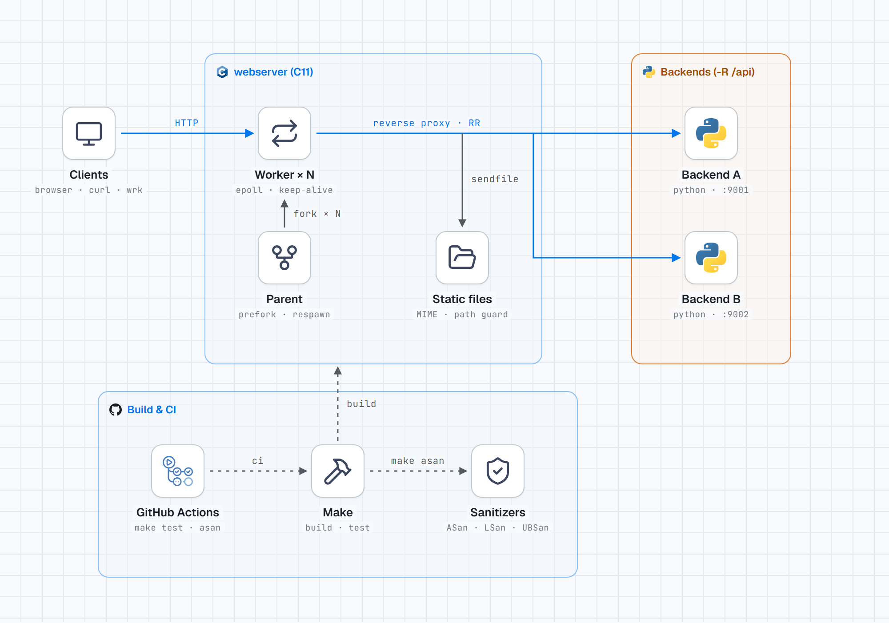
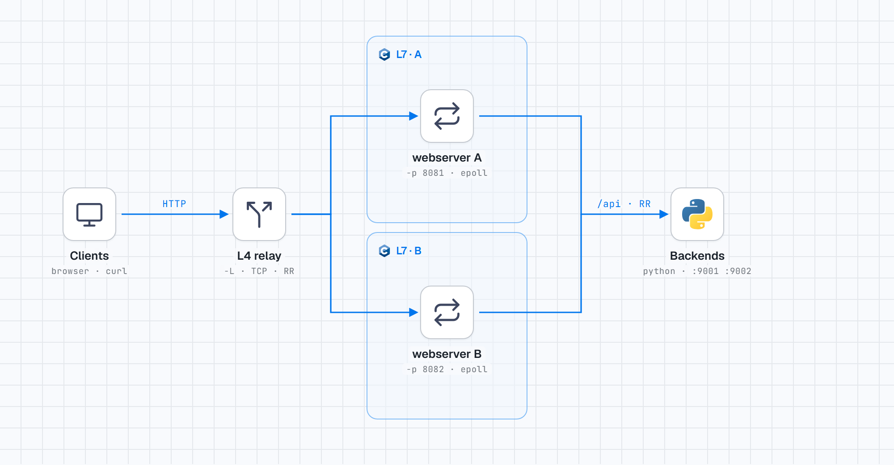
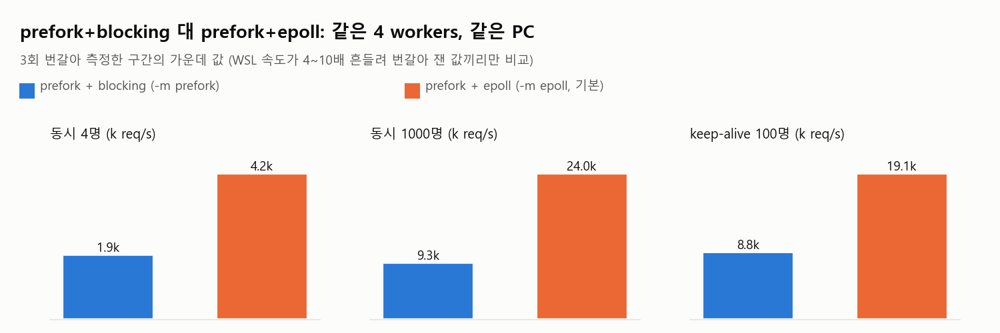
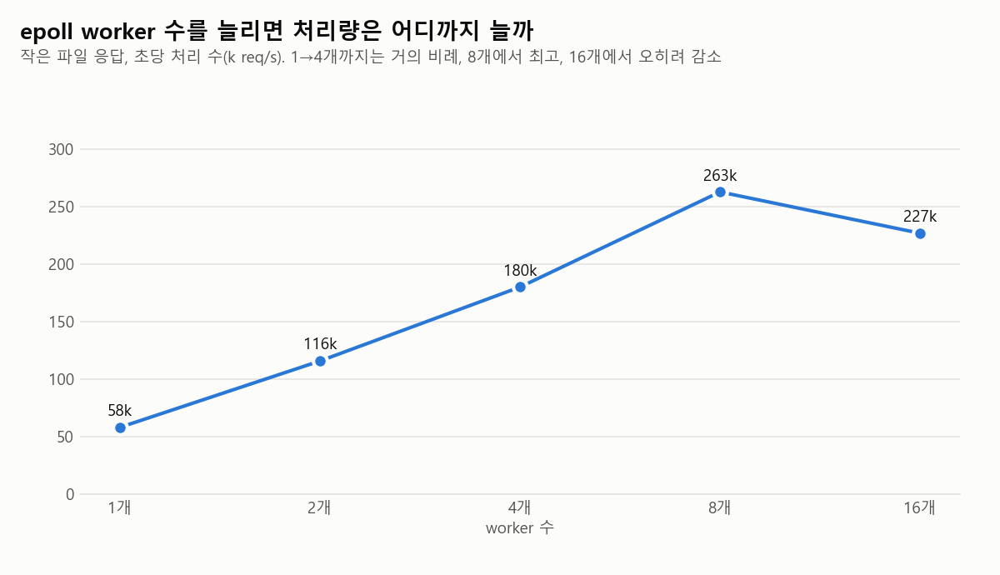
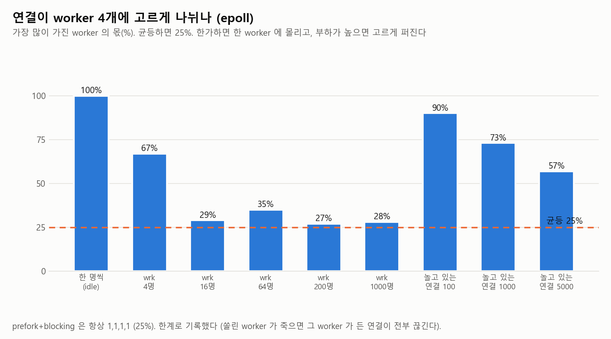
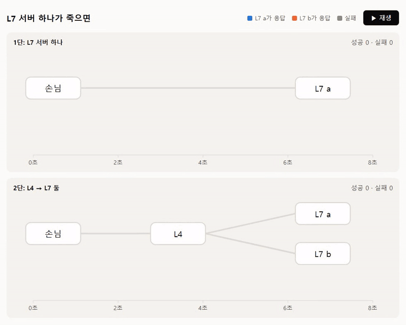
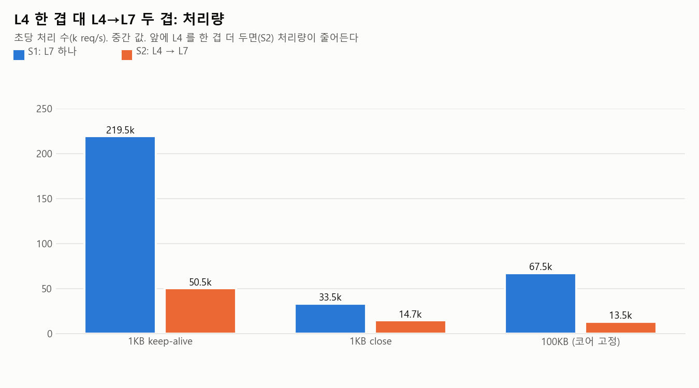

# Team 9 Web Server

크래프톤 정글 WEEK13: C 와 POSIX 소켓 API 만으로 만든 HTTP/1.1 웹 서버 + 리버스 프록시.
외부 HTTP·이벤트 루프 라이브러리(libevent, libuv, nginx 등)는 쓰지 않았습니다.

## 설계 철학: 손님 한 명 때문에 서버가 멈추면 안 된다

웹 서버는 한 번 켜 두면 오래 도는 프로세스이고, 손님(요청)은 우리가 고를 수 없습니다. 이상한 요청, 느린 연결, 중간에 끊는 손님이 언제든 올 수 있습니다. 그래서 선택의 기준을 안정성 하나로 잡고 세 가지로 나눴습니다.

| 기준 | 뜻 | 어기면 |
|---|---|---|
| 피해 범위 | 손님 하나가 서버 전체를 죽이지 못한다 | 요청 하나의 버그·크래시로 모든 손님이 끊김 |
| 자원 상한 | 연결·메모리·시간이 한없이 쌓이지 않는다 | 느리게 보내는 손님 몇 명에게 서버가 마비됨 |
| 상태 격리 | 앞 손님의 흔적이 다음 손님에게 남지 않는다 | 요청 경계가 어긋나 엉뚱한 응답이 나감 |

아래 1~7번은 이 기준으로 무엇을 골랐고 무엇을 버렸는지, 어떻게 확인했는지를 순서대로 적었습니다. 그 대가로 받아들인 것은 [알려진 한계](#알려진-한계)에 모았습니다.

## 구성도

서버 구조: 부모가 worker N 개를 띄우고(죽으면 다시 띄움), 각 worker 는 `epoll` 로 연결 여러 개를 다루며 정적 파일(`sendfile`)을 보내거나 `-R` 경로를 백엔드로 전달합니다(Round-Robin, 실패하면 다음 백엔드, 다 실패하면 502, 무응답이면 504). 아래쪽은 빌드·테스트·CI 도구입니다.

<picture>
  <source media="(prefers-color-scheme: dark)" srcset="docs/architecture-dark.png">
  
</picture>

L4 → L7 2단 구성 (선택, `-L`): L4 중계는 HTTP 를 읽지 않고 TCP 연결을 L7 서버 둘에 나눕니다. L7 하나가 죽으면 건너뜁니다. 같은 PC 의 포트만 다르게 띄웁니다 (8000 → 8081·8082).

<picture>
  <source media="(prefers-color-scheme: dark)" srcset="docs/two-tier-dark.png">
  
</picture>

<sub>그림 속 로고는 각 소유자의 상표입니다 (출처: svgl, gilbarbara/logos, Lucide).</sub>

## 1. 동시성: 피해 범위를 프로세스로 가른다

질문: 요청 하나가 서버를 죽이는 버그를 건드리면 어떻게 되는가?

| | 프로세스 풀 (blocking) | 스레드 풀 | epoll 하나 | prefork + epoll (선택) |
|---|---|---|---|---|
| 한 요청의 크래시 | 그 요청만 | 전체 사망 | 전체 사망 | 그 worker 만 (서버는 계속) |
| 느린 연결 | worker 를 붙잡음 | 스레드를 붙잡음 | 거의 영향 없음 | 거의 영향 없음 |
| 동시 연결 수 | worker 수 | 스레드 수 | 매우 큼 | 매우 큼 |
| 코어 활용 | 여러 코어 | 여러 코어 | 코어 하나 | 여러 코어 |
| 구현 난이도 | 쉬움 | 중간 (락) | 어려움 (상태 기계) | 어려움 |

스레드와 단일 epoll 은 한 번의 segfault 가 서버 전체를 죽이므로 피해 범위 기준에서 탈락했습니다. 프로세스 풀은 격리가 되지만 느린 손님이 worker 를 붙잡아 자원 상한 기준(동시 연결 수가 worker 수에 묶임)에서 아쉽습니다. 그래서 프로세스로 격리하고, 프로세스 안은 epoll 로 돌립니다 (nginx 와 같은 구조). 부모는 worker 를 띄우고 회수하는 관리만 하고, worker 가 무슨 일을 하는지는 모릅니다.

어떻게 정했나: 한 번에 완성하지 않고 먼저 blocking 방식(`-m prefork`)으로 기준점을 만들어 같은 테스트를 통과시킨 뒤, worker 안을 epoll(`-m epoll`, 기본)로 바꿨습니다. 그러면 "epoll 이 뭘 좋아지게 하는가"를 같은 테스트·같은 측정으로 비교할 수 있습니다. 둘 다 프로세스를 미리 만드는 prefork 이고 다른 것은 worker 안이 blocking 이냐 epoll 이냐뿐입니다. 순수 epoll(프로세스 1개)과 스레드 풀은 구현·측정하지 않았고, 위 표는 설명입니다.

### 측정 1: blocking 대 epoll (같은 4 workers)

<picture>
  <source media="(prefers-color-scheme: dark)" srcset="docs/test-prefork-vs-epoll-dark.png">
  
</picture>

환경: Windows 11 + WSL2 Ubuntu (코어 22개), 서버와 `wrk` 가 같은 PC, 작은 파일. 한 실행 안에서 번갈아 3번씩 잰 쌍끼리 비교했습니다 (막대는 3회 범위의 가운데). 숫자는 크기와 방향만 보세요.

- epoll 이 이기는 곳은 "연결이 오래 살거나 많은데 대부분 쉬는" 경우 입니다: keep-alive 재사용, 느린 백엔드를 기다리는 동안 다른 손님 처리(약 45배).
- 짧은 연결(`Connection: close`)에서는 epoll 이 오히려 느립니다. 연결마다 syscall 이 더 들기 때문입니다.
- 노는 연결 1000개를 붙여 놓고 curl 한 번: blocking 은 10초 안에 응답 없음(느린 손님 N 명이 worker N 개를 다 막음), epoll 은 1.8ms. 메모리는 7.8MB 대 9.2MB(연결당 약 1.4KB).
- 부하 중 worker 하나를 `kill -9`: 서버는 둘 다 계속 응답했고, 끊긴 연결은 1개 대 49개입니다. 격리 단위가 "손님 하나"에서 "worker 하나가 든 연결 전부"로 커진 대가이고, 아래 측정 3과 한계에서 다시 다룹니다.

### 측정 2: worker 를 몇 개 둘까

<picture>
  <source media="(prefers-color-scheme: dark)" srcset="docs/test-worker-scaling-dark.png">
  
</picture>

worker 하나가 CPU 를 거의 다 쓰므로(4초 중 4.1초) 4개까지는 거의 비례해 늘었고, 8개에서 가장 높았으며, 16개에서는 오히려 줄었습니다. 기본값은 코어 수(`-w` 로 변경)로 했지만, 이 PC 에서 가장 빠른 worker 수는 코어 수(22개)가 아니라 8개였습니다. 16개에서 줄어든 이유는 확인하지 않았습니다.

### 측정 3: 연결은 worker 에 고르게 나뉘나

<picture>
  <source media="(prefers-color-scheme: dark)" srcset="docs/test-conn-balance-dark.png">
  
</picture>

worker 들이 접수창구(listen 소켓)를 같이 쥐고 있어서 부하가 높으면 고르게 나뉘지만, 한가하거나 노는 연결이 많으면 한 worker 에 쏠립니다. 쏠린 worker 가 죽으면 그 연결이 대부분 끊깁니다. 고치는 방법(부모가 연결을 받아 나눠 주기, `SO_REUSEPORT`)은 알고 있지만 "부모는 관리만 한다"는 설계를 지키려고 한계로 기록했습니다.

## 2. 동적 처리: worker 안에 앱 코드를 두지 않는다

질문: 동적 요청(앱 로직)은 어디서 실행하는가? 과제의 두 예시는 CGI 와 백엔드 전달입니다.

1에서 격리 단위가 worker 한 개로 커졌으니, worker 안에 위험한 앱 코드가 들어가지 않는 편이 철학에 맞습니다. 그래서 앱 로직은 별도 프로세스(백엔드)에서 돌게 하고 우리는 요청을 전달만 합니다. 백엔드가 죽거나 느려도 손님에게 502·504 를 깔끔하게 돌려줄 수 있고, 백엔드 연결도 epoll 이벤트 하나로 다뤄집니다. CGI 는 요청마다 fork·exec 를 하고 환경 변수로 입력을 넘기는 방식이라 이 구조와 맞지 않아 택하지 않았습니다. 이 한 기능이 동적 처리(R5)와 Reverse Proxy(R7)를 함께 만족합니다.

## 3. Proxy: Reverse 만 구현한다

- Forward proxy: 손님을 대신해 아무 서버에나 요청 (손님 쪽에 둠). 목적지를 손님이 정하므로 열어 두면 남이 이 서버를 통해 다른 곳을 공격(SSRF·open proxy)할 수 있고, 목적지 이름 해석(DNS)이 이벤트 루프를 막습니다.
- Reverse proxy: 서버를 대신해 정해진 백엔드로 전달 (서버 쪽에 둠). 목적지는 운영자가 `-R` 로 고정합니다.

Reverse 만 구현한 이유는 피해 범위 기준입니다. 목적지가 고정이라 위 위험이 구조적으로 없고, 백엔드 주소를 시작할 때 한 번 해석하므로 DNS 로 멈추는 일도 없습니다.

- 라우팅: 경로 조각 단위 비교 (`/api`, `/api/x` 는 맞고 `/apix` 는 아님), 대소문자 구분, 접두어는 붙인 채 전달, 규칙이 여럿이면 가장 긴 접두어. 어느 규칙에도 안 맞으면 정적 파일.
- 여러 백엔드: Round-Robin (worker 마다 카운터). 연결이 안 되면 다음 백엔드, 모두 실패하면 502, 응답이 하나도 없으면 504.
- 요청 다시 쓰기: `Connection: close` 로 바꾸고, 손님이 보낸 `X-Forwarded-For` 는 버리고 우리가 본 주소로 씁니다 (위조 방지).

## 4. Connection: 연결을 재사용하되 경계를 정확히 지킨다

HTTP/1.1 은 연결을 기본으로 유지합니다. 정적 응답은 keep-alive 로 재사용하고(연결당 요청 100개 상한, 유휴 `-t` 초) 응답 경계를 `Content-Length` 로 정확히 지킵니다. 앞 요청의 흔적이 뒤 요청에 섞이지 않는 것이 상태 격리 기준입니다. 다음은 항상 `Connection: close` 입니다.

- 오류 응답: 오류 뒤에는 요청 경계를 믿을 수 없습니다.
- 프록시로 중계한 응답: 끝을 백엔드가 연결을 닫는 것으로 알기 때문에 손님 연결도 닫습니다.
- blocking 방식(`-m prefork`): 쉬는 연결이 worker 를 붙잡으므로 항상 닫습니다.

## 5. 손님 입력을 믿지 않는다: 보안·안정성

자원 상한과 상태 격리를 입력 쪽에서 지키는 장치입니다.

- 경로 탈출: 퍼센트 디코딩은 한 번만 → `..` 조각이 있으면 403 → `realpath()` 로 실제 경로가 루트 안인지 조각 단위로 확인(`/srv/www2` 는 `/srv/www` 안이 아님, 심볼릭 링크 포함) → 아니면 403. 루트 밖 파일이 있든 없든 같은 403 을 줘서 파일 존재 여부를 알아낼 수 없게 했습니다.
- 요청 밀반입(smuggling) 방어: `Content-Length` 중복, 헤더 이름 뒤 공백, 줄 접기, 줄 안의 CR·NUL 은 400, `Transfer-Encoding` 은 501.
- 크기 상한: 요청 라인+헤더 8KB (400/414), URI 2KB (414), 본문 1MB (413).
- 느린 손님: 요청은 "첫 바이트부터 `-t` 초 안에 다 와야" 하고 이후 바이트가 와도 마감이 늘지 않아, 1바이트씩 찔끔 보내는 공격도 끊깁니다. (바이트가 올 때마다 마감을 늘리는 방식으로 바꿔 보면 20초 동안 응답이 없었고, 지금 방식은 1.31초에 끊었습니다.)
- 오류 페이지에 요청 경로를 넣지 않습니다 (반사형 XSS 방지). 모든 응답에 `X-Content-Type-Options: nosniff`.

## 6. 종료: 정리하고 끝낸다

SIGINT·SIGTERM 은 표시만 세우고 `epoll_pwait` 안에서만 받아 놓치는 틈이 없습니다. 보내던 응답은 끝내고, 쉬는 연결은 닫고, 소켓·메모리를 정리합니다. SIGPIPE 는 무시해서 끊긴 손님에게 써도 서버가 죽지 않습니다. worker 가 죽으면 부모가 다시 띄웁니다.

## 7. L4 → L7 2단 구성으로 가용성을 올린다 (선택)

질문: L7 서버 하나가 죽으면 그 서버로 가던 손님은? 앞에 HTTP 를 읽지 않는 L4(TCP) 중계를 두어 연결을 L7 서버 둘에 나누고, 하나가 죽으면 건너뛰게 했습니다.

아래 화면은 0.3초마다 요청을 보내다가 3초에 L7 a 를 `kill -9`(프로세스 그룹째)로 죽인 실제 실행 기록을 재생한 것입니다. 1단은 죽은 뒤 요청이 모두 실패하고, 2단은 L4 가 남은 L7 b 로 계속 보내 실패가 없습니다 (요청 24개씩, 1단 성공 9·실패 15, 2단 성공 24·실패 0).

<picture>
  <source media="(prefers-color-scheme: dark)" srcset="docs/demo-l7-kill-dark.gif">
  
</picture>

<picture>
  <source media="(prefers-color-scheme: dark)" srcset="docs/test-l4-l7-dark.png">
  
</picture>

| 가용성 시험 (초당 25건 × 8초) | 성공률 |
|---|---|
| 1단에서 L7 하나가 죽음 | 33% |
| 2단에서 L7 하나가 죽음 | 100% |
| 2단에서 L7 하나가 멈춤 (`SIGSTOP`) | 66% |
| 2단에서 L4 가 죽음 | 33% |

같은 PC 에서 2단은 처리량을 떨어뜨립니다(0.2~0.45배). 우리 L4 는 모든 바이트를 사용자 공간으로 읽어 다시 쓰는데 L7 은 `sendfile` 로 커널이 바로 보내서 L4 가 먼저 막힙니다 (실제 L4 로드밸런서는 패킷을 커널·NIC 에서 전달해 이 복사가 없습니다). 이 구조에서 얻는 것은 가용성입니다. 단, 멈춘 서버는 건강 검사가 없어 못 알아채고(절반이 실패), L4 가 죽으면 전부 실패합니다 (단일 장애점이 L4 로 옮겨감).

## 어떻게 확인했나

각 기준을 어기는 상황을 실제로 만들어 서버가 버티는지 보았습니다.

| 기준 | 어기는 상황을 만든 시험 | 결과 |
|---|---|---|
| 피해 범위 | 부하 중 worker `kill -9` / 응답을 받다가 끊기는 손님(SIGPIPE) / 응답 도중 끊기는 백엔드 / 백엔드 하나 죽음 | 서버는 계속 응답, worker 는 되살아남, 나머지 백엔드로 우회 |
| 자원 상한 | 노는 연결 1000개 / 1바이트씩 찔끔 / 응답 없는 백엔드 / 1MB 넘는 본문·2KB 넘는 URI·8KB 넘는 헤더 | 새 손님 응답 1.8ms, `-t` 안에 끊김, 504·413·414·400 |
| 상태 격리 | 파이프라인 요청 연속 / 한 연결 100개 초과 요청 / 오류 뒤 연결 / `Content-Length` 중복·Host 없음 | 요청마다 따로 응답, 상한에서 닫음, 오류 뒤 close, 400 |

### 과제 품질 항목별: 왜 이 시험을 했고 어떻게 했나

| 항목 | 왜 (무엇을 증명) | 어떻게 |
|---|---|---|
| 단위 테스트 | 소켓 없이도 판정이 맞는지 (파서가 "덜 옴 / 다 옴 / 잘못됨"을 가르는 경계가 핵심) | `make test` 12종 (파서·MIME·경로·라우팅·프록시 전달·응답·정적 파일·인자·시그널·prefork·요청 읽기 마감·소켓). 일반 빌드와 sanitizer 빌드 모두 통과 |
| 기능 테스트 | 부품이 맞아도 합쳐서 맞는지 | `make functional`: 서버와 파이썬 백엔드 2개를 실제로 띄워 `curl`·`nc` 로 53개(epoll)·46개(prefork) 시나리오 |
| 동시 다중 접속 | 동시에 와도 응답이 섞이거나 빠지지 않는지, Round-Robin 이 정말 나누는지 | 동시 40명 × 1000 요청 전부 200, 10번 요청이 5:5 분배 |
| 부하 | 동시 접속 수별 처리량·지연과 모델 간 차이 | `wrk` (`compare.sh`, `lb.sh`), 위 측정 1~3 |
| 메모리 | 오래 켜 두어도 자원이 새지 않는지 | `make asan` (AddressSanitizer + LeakSanitizer + UBSan): 단위 12종, 그리고 서버를 같은 방식으로 빌드해 기능 테스트와 L4 시험을 돌려 종료 시 누수 보고 없음 |
| 엣지: 잘못된 요청 | 이상한 입력에 죽지 않고 올바른 오류 코드를 주는지 | 불완전한 헤더(바이트가 나뉘어 와도 모든 앞부분이 "덜 옴"), Host 없음 400, 깨진 요청 라인 400, 비정상 메서드 405·501, 잘못된 버전 505, `Transfer-Encoding` 501 |
| 엣지: 큰 본문·긴 URI | 크기 상한이 실제로 걸리는지 | 본문 2MB 413, URI 3000자 414, 헤더 8KB 초과 400 |
| 엣지: 백엔드 무응답·타임아웃 | 백엔드 탓에 손님이 영원히 기다리지 않는지 | 응답 없는 백엔드 504(걸린 시간이 `-t` 근처인지도 확인), 꺼진 백엔드 502, 백엔드 하나 죽으면 나머지로 우회 |
| 엣지: 갑작스러운 연결 종료 | 손님이 끊어도 서버가 살아 있고 자원이 회수되는지 | 요청 헤더 도중 끊기, 응답 받다가 끊기, 부하 중 `kill -9` 뒤 복구, 부하 중 SIGTERM 정리 종료(종료 코드 0) |

테스트가 정말 결함을 잡는지도 확인했습니다. 일부러 결함을 넣어(마감 방식, Host 필수, Content-Length 중복, 부분 쓰기, `..` 검사, 루트 안 검사, RR, 장애 우회, keep-alive, 파이프라이닝 등 30여 개) 모두 검출됨을 보았습니다. 부분 쓰기는 타이머에 기대지 않도록 `write` 를 가짜로 바꿔 끼워(`-Wl,--wrap=write`) 시험합니다.

확인하지 못한 것: 실제 브라우저로는 확인하지 않았습니다(`curl`·`nc`·`wrk` 만). 부하 도구는 `wrk` 만 썼고(`ab`·`hey` 미사용), 메모리는 valgrind 대신 sanitizer 를 썼습니다. 부하를 거는 동안 sanitizer 서버의 누수를 본 시험은 없고, 1MB 이하의 큰 본문이 여러 번에 나뉘어 올 때(입력 버퍼가 늘어나는 경로)를 실제 서버로 직접 보낸 시험도 없습니다(파서 단위 테스트만 있음).

### 결함을 찾은 과정에서 배운 것

- epoll 첫 구현은 기능 테스트 53개를 모두 통과했지만 응답마다 40ms 가 더 걸렸습니다. 헤더(`send`)와 본문(`sendfile`)이 따로 나가 Nagle 알고리즘이 두 번째 조각을 붙잡고 손님의 지연 ACK 를 기다린 것입니다. 연결 하나로 순차 요청해 보니 43ms → `TCP_NODELAY` 와 헤더 `MSG_MORE` 로 0.6ms. 기능 테스트가 모두 통과해도 성능은 따로 재야 한다는 것을 이때 알았습니다.
- 경로 탈출 방어를 두 겹(`..` 조각 검사 + `realpath` 검사)으로 둔 이유는, 뒤 검사만 있으면 루트 밖 파일이 있을 때 403, 없을 때 404 로 갈려 파일 존재 여부를 떠볼 수 있기 때문입니다. 한 겹을 지워도 테스트가 통과하던 것을 변이 확인으로 발견해 이 성질을 고정하는 테스트를 넣었습니다.

## 알려진 한계

안정성을 우선하며 받아들인 대가와, 하지 않은 것입니다.

- 연결 쏠림 (1의 측정 3): 한가하거나 노는 연결이 많으면 연결이 한 worker 에 쏠리고, 그 worker 가 죽으면 연결이 대부분 끊깁니다. Node.js cluster 문서에도 같은 현상(worker 8개 중 2개에 연결의 70% 이상)이 적혀 있습니다. 개선 방향은 부모가 연결을 받아 Round-Robin 으로 나눠 주는 방식(Node.js cluster 기본)이나 `SO_REUSEPORT`(nginx `reuseport`)이지만, 부모를 관리만 하게 두는 설계를 지키려고 구현하지 않았습니다.
- 프록시는 요청마다 새 백엔드 연결을 맺고, 응답 뒤 손님 연결도 닫습니다 (백엔드 커넥션 풀과 프록시 응답의 keep-alive 는 없음). 백엔드가 `Connection: close` 를 적지 않으면 손님은 닫힘을 예고 없이 만납니다.
- 백엔드 주소는 IPv4 만, 시작할 때 한 번 해석합니다 (중간에 주소가 바뀌면 재시작).
- L4 중계는 사용자 공간 TCP 중계이고 건강 검사·독 요청 방어는 없습니다.
- chunked 전송(`Transfer-Encoding`)은 501, HTTPS 는 없음, 응답 캐시는 없음.
- 측정은 한 PC·작은 파일·표본 3개입니다.

## 요구사항 한눈에

| 요구사항 | 구현 |
|---|---|
| TCP 소켓 서버 | `getaddrinfo → socket → SO_REUSEADDR → bind → listen → accept` |
| HTTP 파싱 | 요청 라인·헤더·`Content-Length` 본문, 나뉘어 오는 요청, 파이프라이닝. 버퍼를 "덜 옴 / 다 옴 / 잘못됨" 으로 판정하는 순수 함수 |
| 응답 생성 | `Date`·`Content-Type`·`Content-Length`·`Connection`, 오류 페이지, 부분 쓰기 처리 |
| 정적 파일 + MIME | 15종 확장자, 디렉터리는 `index.html`, GET·HEAD, `sendfile` |
| 오류 응답 | 400 · 403 · 404 · 405(+`Allow`) · 413 · 414 · 500 · 501 · 502 · 504 · 505 |
| 동적 처리 | 백엔드로 요청을 전달 (리버스 프록시) |
| 동시성 | prefork + epoll (비교용으로 prefork + blocking `-m prefork` 유지) |
| Reverse Proxy | 경로 라우팅, Round-Robin, 장애 우회, 502 / 504 |
| Connection | HTTP/1.1 keep-alive (정적), 프록시 응답과 오류 뒤에는 `close` |
| 종료 | SIGINT·SIGTERM 정리 종료, SIGPIPE 무시 |
| 추가 | L4(TCP) 중계 모드 (`-L`) 로 "L4 → L7 2단" 구성 |

### 모듈

| 파일 | 하는 일 |
|---|---|
| `main.c` | 인자 → 준비(대기 소켓, 시그널, 백엔드 주소) → worker 들을 띄워 맡김 |
| `config` · `route` · `request` · `path` · `mime` | 순수 함수: 입출력 없이 문자열만 다뤄 단위 테스트가 쉬움 |
| `response` · `static` | 응답 만들기, 정적 파일 열기 (소켓은 안 건드림) |
| `prefork` | worker 를 띄우고, 죽으면 다시 만들고, 종료 때 전부 회수. worker 가 무슨 일을 하는지 모름 |
| `evloop` | worker 안에서 도는 `epoll` 이벤트 루프 (정적 + 프록시, keep-alive) |
| `worker` · `proxy` | blocking 방식 worker (비교 기준점) 와 그 프록시 |
| `l4` | L4 중계 모드 |

## 빌드 · 실행

Linux / WSL2 / Dev Container(`.devcontainer/`, Ubuntu 22.04). C11, `make`.

```bash
make                                              # ./webserver 빌드
./webserver -p 8080 -r www                        # 정적 파일 서버
./webserver -p 8080 -r www -R /api=127.0.0.1:9001,127.0.0.1:9002   # /api 는 백엔드 둘로 (Round-Robin)
./webserver -p 8000 -L 127.0.0.1:8081,127.0.0.1:8082               # L4 중계: 연결을 서버 둘로 나눔
curl -i http://127.0.0.1:8080/
```

| 옵션 | 뜻 | 기본 |
|---|---|---|
| `-p 포트` | 듣는 포트 (필수) | |
| `-r 폴더` | 정적 파일 루트 (필수, `-L` 이면 안 씀) | |
| `-R /접두어=host:port[,host:port]` | 이 경로는 백엔드로 전달. 여러 번 줄 수 있음 (최대 8개) | |
| `-t 초` | 요청 읽기·응답 쓰기·백엔드 무응답 타임아웃 | 5 |
| `-w 수` | worker 프로세스 수 (1~256) | 코어 수 |
| `-m epoll\|prefork` | worker 의 방식 | epoll |
| `-L host:port[,host:port]` | L4 중계 모드 | |

```bash
make test         # 단위 테스트 12종
make asan         # 같은 테스트를 AddressSanitizer + LeakSanitizer + UBSan 으로
make functional   # 실제 서버를 띄워 curl·nc 로 53개 시나리오 (MODEL=prefork 로 다른 방식도)
bash tests/lb.sh  # L4 → L7 2단 구성 기능·속도·가용성 (wrk 필요)
bash tests/compare.sh   # prefork 대 epoll 비교 측정 (wrk 필요)
```

## 팀

| 이름 | GitHub |
|---|---|
| | [@cc8s](https://github.com/cc8s) |
| | [@bennjung](https://github.com/bennjung) |
| | [@YoonJinhoon](https://github.com/YoonJinhoon) |
