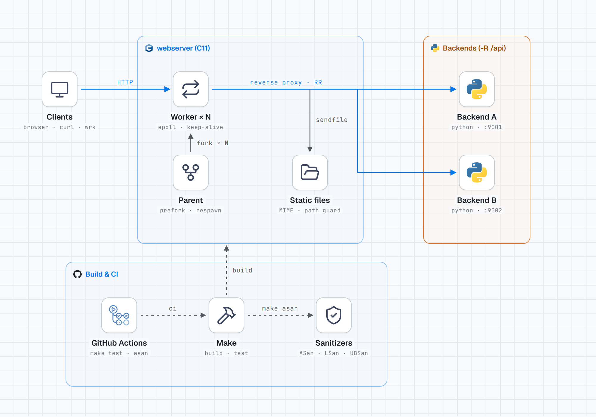
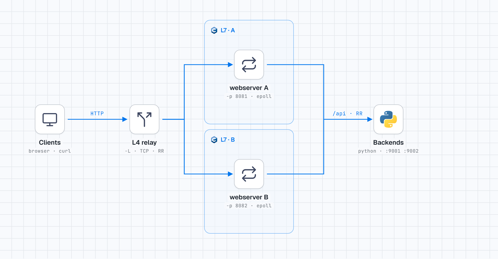
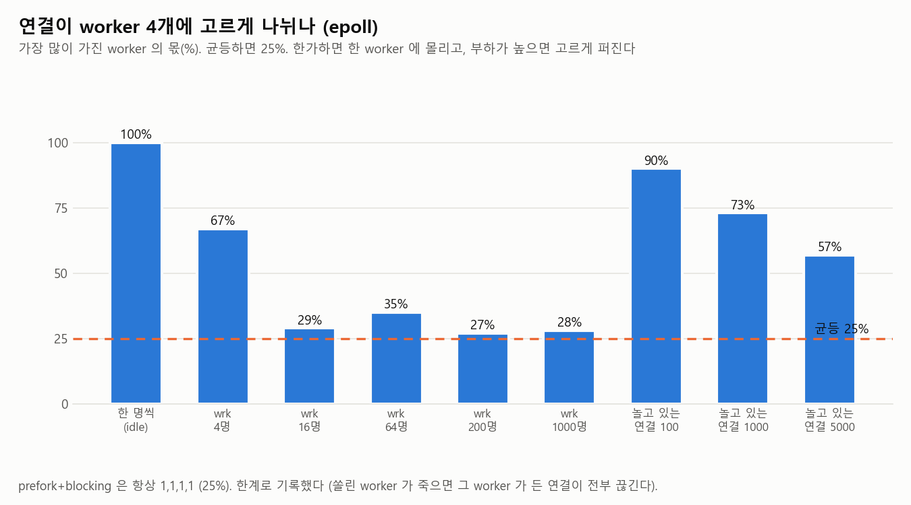
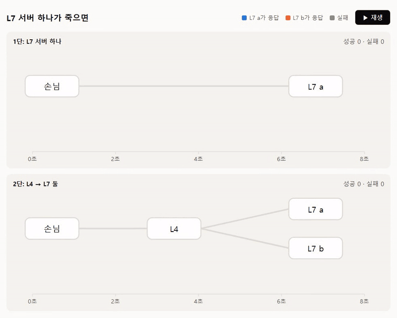

# Team 9 Web Server

크래프톤 정글 WEEK13: C와 POSIX 소켓 API만으로 만든 HTTP/1.1 웹서버 + 리버스 프록시.
외부 HTTP·이벤트 루프 라이브러리(libevent, libuv, nginx 등)는 쓰지 않았습니다.

## 1. 설계철학

### 안정성 

선택의 기준은 안정성이었습니다. 요청 하나의 오류가 서버 전체로 번지지 않게 하고, 느린 연결 때문에 다른 클라이언트까지 기다리는 상황을 줄이고자 했습니다.

### Case 1. 멀티프로세스 + epoll

**프로세스로 장애를 격리하고, 각 워커는 epoll로 여러 연결을 처리합니다.**

- **멀티프로세스**: 한 스레드의 segfault는 같은 프로세스 전체를 종료시킬 수 있습니다. 워커를 별도 프로세스로 나누면 해당 워커의 장애가 다른 워커로 번지는 것을 막을 수 있습니다. 부모는 워커를 생성하고, 죽으면 회수한 뒤 다시 생성합니다.
- **epoll**: blocking 방식에서는 느린 연결 하나가 워커 하나를 붙잡습니다. 각 워커에 epoll을 사용해 클라이언트나 백엔드의 데이터를 기다리는 동안에도 다른 연결을 처리합니다.
- **역할 분리**: 정적 파일은 웹서버가 직접 응답하고, `-R`로 지정한 API 경로의 요청은 별도 백엔드로 전달합니다. 동적 처리 코드를 워커 안에서 실행하지 않고, 백엔드의 응답을 클라이언트로 중계합니다.
- **백엔드 분산**: 백엔드가 여러 대면 각 워커가 자신의 카운터로 Round-Robin 분산합니다. 연결이 실패하면 다음 백엔드로 우회하고, 모두 실패하면 502, 응답이 없으면 504를 반환합니다.

<picture>
  <source media="(prefers-color-scheme: dark)" srcset="docs/architecture-dark.png">
  
</picture>

> 백엔드로의 Round-Robin 분산과 워커 사이의 클라이언트 연결 분산은 별개입니다. 워커 간 연결 분산은 아래 시나리오 2에서 확인합니다.

먼저 blocking 방식으로 기준점을 만든 뒤 워커 안을 epoll로 바꿔 비교했습니다. 같은 워커 4개에서 노는 연결 1,000개를 열고 새 요청을 보냈을 때, blocking은 10초 안에 응답하지 못했고 epoll은 1.8ms에 응답했습니다. 다만 짧은 연결에서는 epoll이 오히려 느렸습니다.

### Case 2. L4 → L7 2단 로드밸런서

**웹서버가 한 대뿐이면, 그 서버가 죽었을 때 백엔드가 살아 있어도 서비스를 제공할 수 없습니다.**

앞서 설명한 웹서버를 두 개 배치하고, 앞에 L4 중계를 추가했습니다. L7 웹서버가 HTTP 요청을 처리하므로, 앞단은 HTTP 내용을 해석하지 않고 TCP 연결 단위로 분산합니다.

1. 클라이언트의 연결을 받으면 웹서버 하나를 선택
2. 선택한 웹서버에 TCP 연결을 맺고 양쪽 데이터를 중계
3. 해당 웹서버에 연결할 수 없으면 다른 웹서버로 우회 (L4 8000 -> L7 8081 or 8082)

<picture>
  <source media="(prefers-color-scheme: dark)" srcset="docs/two-tier-dark.png">
  
</picture>

<sub>그림 속 로고는 각 소유자의 상표입니다 (출처: svgl, gilbarbara/logos, Lucide).</sub>

이 구성의 목적은 **가용성**입니다. 같은 PC의 측정에서는 사용자 공간 중계 비용 때문에 처리량이 단일 L7의 0.2~0.45배로 줄었습니다.

## 2. 생성 코드 검증 시나리오

### Scenario 1. L7 웹서버 하나를 강제로 종료하면?

**확인할 것:** L4가 연결할 수 없는 L7을 건너뛰고 다른 L7으로 우회하는가?

단일 L7 구성과 L4 → L7 2단 구성에 요청을 보내는 도중 L7 웹서버 하나를 강제로 종료했습니다.

| 시험 조건 | 단일 L7 | L4 → L7 둘 |
|---|---|---|
| 초당 25건 × 8초, 도중에 L7 하나 종료 | 요청 성공률 **33%** | 요청 성공률 **100%** |

해당 실험에서는 2단 구성이 다른 L7으로 우회하며 요청을 계속 처리했습니다. 이 성공률은 실험 결과이지, 모든 장애 상황에서 무중단을 보장한다는 뜻은 아닙니다.

| 추가 장애 시험 | 2단 구성의 요청 성공률 |
|---|---|
| L7 하나를 종료하지 않고 멈춤 (`SIGSTOP`) | 66% |
| 앞단 L4 종료 | 33% |

건강 검사가 없어 멈춘 L7을 걸러내는 데 한계가 있고, L4 자체도 단일 장애점으로 남습니다. 위 성공률은 장애 전후를 포함한 시험 구간 전체의 값입니다.

### Scenario 2. 연결은 워커에 고르게 나뉘나?

**확인할 것:** 워커 4개가 연결을 약 25%씩 담당하는가?

부하를 주는 경우와 데이터를 보내지 않고 연결만 열어두는 경우를 나눠, 가장 많은 연결을 가진 워커의 비중을 측정했습니다.

| 조건 | 가장 많은 연결을 가진 워커의 비중 | 균등 분산 기준 |
|---|---|---|
| 동시 접속 1,000개 부하 | **28%** | 25% |
| 데이터를 보내지 않는 연결 1,000개 | **73%** | 25% |

<picture>
  <source media="(prefers-color-scheme: dark)" srcset="docs/test-conn-balance-dark.png">
  
</picture>

워커가 같은 대기 소켓을 공유하더라도 연결이 항상 균등하게 나뉘지는 않았습니다. 높은 부하에서는 비교적 고르게 나뉘었지만, 노는 연결은 한 워커에 쏠렸습니다.

**프로세스로 장애를 격리하더라도, 연결이 쏠린 워커가 죽으면 많은 연결이 한꺼번에 끊길 수 있습니다.** 부모가 연결을 받아 분배하거나 `SO_REUSEPORT`를 사용하는 개선 방향은 있지만, 현재 구현에는 적용하지 않고 한계로 기록했습니다.

## 3. 데모: 단일 L7 vs. 2단 로드밸런서

**실제 실행 기록을 재생한 애니메이션입니다.** 0.3초마다 요청을 보내다가 3초에 L7 A를 `kill -9`로 프로세스 그룹째 종료했습니다.

<picture>
  <source media="(prefers-color-scheme: dark)" srcset="docs/demo-l7-kill-dark.gif">
  
</picture>

| 데모 결과 | 단일 L7 | L4 - L7 |
|---|---|---|
| 총 요청 | 24개 | 24개 |
| 성공 / 실패 | **9 / 15** | **24 / 0** |

> 이 데모는 시나리오 1의 초당 25건 × 8초 시험과 별도 실행입니다. 단일 L7의 데모 성공률은 9/24 = 37.5%이며, 앞의 시험 결과 33%와 구분합니다.

| 순서 | 단일 L7 | L4 - L7 |
|---|---|---|
| 정상 상태 | 클라이언트 → L7 | 클라이언트 → L4 → L7 A 또는 B |
| L7 하나 종료 | 유일한 웹서버에 연결할 수 없음 | L7 A에 연결 실패 시 L7 B로 우회 |
| 장애 이후 | 서비스 제공 불가 | 살아 있는 L7로 새 연결 처리 |

> 장애 우회는 이미 끊어진 TCP 연결을 복구하는 기능이 아닙니다. L4가 L7에 연결하는 과정에서 실패했을 때 다른 L7을 시도합니다.

---

## 부록

발표에 사용한 내용과 수치의 원본은 [README.md](README.md)입니다.

### 빌드 · 실행

Linux / WSL2 / Dev Container(`.devcontainer/`, Ubuntu 22.04). C11, `make`.

```bash
make
./webserver -p 8080 -r www
./webserver -p 8080 -r www -R /api=127.0.0.1:9001,127.0.0.1:9002
./webserver -p 8000 -L 127.0.0.1:8081,127.0.0.1:8082
curl -i http://127.0.0.1:8080/
```

`-L` 실행 예시는 L7 두 개가 별도로 실행 중인 상태를 전제로 합니다.

### 검증 도구

```bash
make test               # 단위 테스트 12종
make asan               # AddressSanitizer + LeakSanitizer + UBSan
make functional         # 실제 서버 기능 테스트 (epoll 53개, prefork 46개)
bash tests/lb.sh        # L4 → L7 기능·속도·가용성 시험 (wrk 필요)
bash tests/compare.sh   # blocking과 epoll 비교 측정 (wrk 필요)
```

테스트 자체도 일부러 결함을 넣어 확인했습니다. 마감 방식, Host 필수, Content-Length 중복, 부분 쓰기, 경로 검사, Round-Robin, 장애 우회 등 30여 개 결함을 검출했습니다.

### 발표 외 안정성 기준: 상태 격리

원본 README의 안정성 기준은 피해 범위·자원 상한·상태 격리입니다. 발표 본문은 앞의 두 기준에 집중했습니다.

상태 격리는 앞 요청의 데이터나 처리 상태가 다음 요청에 섞이지 않게 하는 것입니다. 정적 응답은 `Content-Length`로 응답 경계를 지키며 keep-alive로 연결을 재사용합니다. 오류 응답과 프록시 응답 뒤에는 연결을 닫습니다. 파이프라이닝, 오류 뒤 연결 종료, 중복 `Content-Length` 거부 등을 테스트했습니다.

### 측정과 구현의 한계

- 측정은 한 PC·작은 파일·표본 3개에 한정됩니다. 일반적인 성능 보장으로 해석하지 않습니다.
- 성능 측정 환경은 Windows 11 + WSL2 Ubuntu, 코어 22개이며 서버와 `wrk`를 같은 PC에서 실행했습니다. 시간대별 속도 편차가 커서 한 실행 안에서 번갈아 3회 측정한 쌍끼리 비교했습니다.
- 스레드 풀과 단일 프로세스 epoll은 구현·측정하지 않았습니다. 실제 비교 대상은 prefork + blocking과 prefork + epoll입니다.
- 같은 PC의 포트만 나눴으므로 PC 자체의 장애에 대비한 구성은 아닙니다.
- L4 중계에는 건강 검사가 없으며, L4 자체가 단일 장애점입니다.
- 프록시는 요청마다 새 백엔드 연결을 맺고 응답 후 클라이언트 연결도 닫습니다.
- 실제 브라우저 확인과 부하 중 sanitizer 서버의 누수 검사는 수행하지 않았습니다.

## 팀

| 이름 | GitHub |
|---|---|
| | [@cc8s](https://github.com/cc8s) |
| | [@bennjung](https://github.com/bennjung) |
| | [@YoonJinhoon](https://github.com/YoonJinhoon) |
